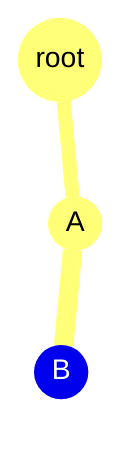

# StateTree

Есть возможность создать:
- StateTree - нужен для дверей или компонентов, для которых не нужен AI контроллер.
- StateTree Ai Component - нужен AI Controller.

Классическое название - **ST_name**

StateTree — это не прямой заменитель Behavior Tree, а альтернативная модель поведения. Основная мотивация:
- логика становится более структурированной;
- условия входа и переходы описаны явно;
- StateTree хранит текущее состояние и решает, когда переключиться в другой state;
- такой подход часто удобен для AI с ограниченным числом режимов поведения.

Важно: BT и StateTree решают похожие задачи, но в разных моделях выполнения. Behavior Tree чаще выбирает ветки по условиям и задачам, а StateTree опирается на явные состояния, их входы и переходы.

В StateTree в разделе Details есть:
- Parameters - переменные, которые можно добавить.
- Enter Condition - правило входа в данную ветку, если условие не удовлетворяется, то вход в данный state не будет.
- Tasks - какие задачи нужно выполнить на данном state.
- Transition - куда состояние переходит в следующую очередь.
Брать переменные из объекта, к которому относится StateTree, можно через Context\Actor, Context\AI Controller.

В Transitions, при добавлении нового transition есть Trigger, который по умолчанию равен On State Completed. Есть и другие условия: состояние может считаться завершенным успешно, завершенным с ошибкой или проверяться на каждом тике. Важно понимать, что задача не обязана обязательно вызывать `TaskFinished`/`TaskCompleted` вручную — логика зависит от реализации задачи и используемого триггера. Для простых сценариев можно использовать `On Tick`, когда условие перехода проверяется постоянно.

У задачи есть различные функции, например EnterState — в момент входа в состояние задача начинает выполняться.

После того, как StateTree повешан на объект, нужно убедиться, что флажок Start Logic Automatically стоит в true, чтобы логика автоматически запускалась. С версии 5.6 дефолнтое значение - true.

Когда происходит работа с ботами нужно:
- Создать самого бота
- Создать AI Controller

В AIController нужно добавить новый компонет, в который будет установлен StateTree AI (не просто StateTree, т.к. будет работа с контроллером).
В боте установить AIController

Поговорим об особенностях Задач.
В задачах можно устанавливать переменные (например AIOwner, наш бот) и по умолчанию она будет None, что не безопасно, код будет скомпилирован, но не правильно выполнять его.
У каждой такой переменной в поле Category есть три значения:
- Context - автоматически связаывает ее с какой-то переменной из контекста.
- Input/Output - в рамках 1 стейта, 1-на задача может выполнять некоторые действия и отдавать выходные параметры, в другой задаче  эти параметры можно использовать, если они помечены как input (можно биндить на output переменные). Удобно, т.к. можно делать базовые блоки и разделять логику в целом. Если имеется output переменная, получившая значения только после асинхронной задачи (делегата), то будет задержка в получении output данных, а зависимая от нее задача уже может выполняться. Это можно исправить:
- через или дополнительную переменную в вашем боте и child состояния относительно текщущего, в котором происходит асинхронная работа.
- Должна быть связь - родитель, ребенок, тогда после асинхронной задачи и ее завершения, будет выполняться задача из состояния ребенка и он будет иметь доступ к otuput переменной. 
Важно: 
представим себе следующее дерево:


root - корень
A - следующий стейт
B - дочерний стейт к B

Если стейт B завершается достаточно быстро и после перехода к root идет в стейт A который тоже завершается и тем самым завершает все свое поддерево, если Selection Behavior определен как - Try Select Children In Order. В данном случае можно убрать Finished Task у A, но тут есть нюанс, что т.к. у нас нет задача A не финишируется, то все output элементы стейта A, переходящие в input стейты B, еще могут быть не определены, если они завязаны на асинхронной работе в задаче стейта A. Для решения данной проблемы, стоит использовать стандартные задачи, если так таковые имеются или добавлять дополнительные проверки.

Теперь поговорим о том, что такое Evaluators.
Evaluators предназначены для вычислений и обновления данных, которые нужны StateTree, но само вычисление не должно напрямую менять поведение мира. Их главная роль — хранить и обновлять значения, которые потом используются в условиях, task и переходах.
Global Task — это задача, которая активна в течение всего времени жизни дерева. Она может быть полезна для поддержания глобального состояния или контекста, который должен быть доступен при запуске и во время работы дерева.


# AI

Для создания ботов и прочих сущностей, которым будет управлять ИИ (искуственный интеллект), нужно создавать:
- AI Controller.
- Behavior Tree/ State Tree
- В случае Behavior Tree нужен еще Blackboard, который будет хранить нужные данные т.к. BT, не может этого хранить.
- Персонаж

У самого Pawn можно установить AI Player Controller.
Опция Auto posses AI (по умолчанию Placed in World)  говорит нам о том, контроллер к нему не будет автоматически создавать, а будет искаться на карте. Лучше ставить Placed In World or Spawn, чтобы создавать контроллер, если его нет.

# EQS

EQS (Environment Query System) -  система запросов в окружающую среду, для того чтобы искуственный интеллект выполнял какие-либо функции, например, выбрать точку, на которую должен прийти бот.

В EQS скрипте используется набор предвыбранных генераторов, на основании которых можно создавать/выбирать точки.

Чтобы проверить как работает EQS, стоит использовать EQS Pawn.

В самом генераторе есть следующие настройки:
- Grid Half Size - половина размера сетки.
- Space Between - расстояние между точками.
- Generate around - точка-центр генерации EQS.
- Projection Data - отвечает за проекцию точек вниз/вверх, чтобы они "приземлились" на навигацию или геометрию, а не висели в воздухе.
	- Trace mode - отвечает за выбор, как точка будет генерироваться (проекция по навигации).
- Auto Sort Tests - тесты автоматически сортируются по порядку выполнения.
- Can Run Async - позволяет ли EQS-запросу выполняться асинхронно.

Каждый из генераторов должен выполнять генерацию на основании каких-либо параметров:
- Расстояние
- Видимость объектов
- Теги
и многие другие параметры, поэтому на генератор нужно добавлять конкретный ***Тест*** — по какому критерию будет выбираться сгенерированная точка.
В самом тесте помимо фильтров для точек есть параметр Score — то, какая оценка будет задана точкам и по какой кривой это будет сделано (линейной, константной, квадратичной и т. п.).

## StateTree: ключевые идеи по документации Epic

StateTree — это иерархический state machine, который объединяет идею селекторов из Behavior Tree и состояния/переходы из обычных state machines. Суть в том, что логика становится более структурированной и при этом достаточно быстрой.

### Как работает выбор состояния

- Состояния располагаются в дереве.
- Выбор начинается от root.
- На каждом шаге проверяются Enter Conditions для состояния.
- Если условие прошло, выполнение идёт дальше в дочерние стейты.
- Если дочерних состояний нет, дальнейшее поведение зависит от Selection Behavior: в обычных режимах выбора детей листовое состояние выбирается само, а `None` не позволяет выбрать состояние напрямую.
- Когда состояние выбрано, активными становятся оно и все родительские состояния.

Это важно: StateTree не просто "выполняет задачу по ветке", а держит активную ветку состояний и решает, когда надо сделать переход.

### Поведение выбора состояния (Selection Behavior)

Параметр **Selection Behavior** задаёт, как StateTree продолжает выбор, когда состояние рассматривается для активации: выбрать само состояние, спуститься к его детям или попытаться следовать подходящим переходам. Это не то же самое, что условие входа (`Enter Condition`) или триггер перехода (`On Tick`, `On Event` и т. п.).

| Вариант | Роль |
|---|---|
| **Try Enter** (`TryEnterState`) | Выбрать это состояние, даже если у него есть дети. Используется, когда нужно остановить выбор на этом уровне. |
| **Try Select Children In Order** | Проверять детей по порядку в дереве и выбрать первую ветку, которая успешно проходит дальнейший выбор и условия входа. Если детей нет, выбирается само состояние. Это поведение по умолчанию. |
| **Try Select Children At Random** | Случайно выбирать одного из ещё не опробованных детей и пробовать его ветку. Если выбор ветки не удался, ребёнок исключается и попытка повторяется. Если детей нет, выбирается само состояние. |
| **Try Select Children With Highest Utility** | Оценить детей с учетом Utility Considerations и веса состояния, затем попробовать выбрать кандидата с наибольшей оценкой. Если ветка не выбирается, попробовать следующего по оценке кандидата. При равной оценке изначально сохраняется порядок детей, но после неудачной попытки порядок оставшихся кандидатов не гарантирован. |
| **Try Select Children At Random Weighted By Utility** | Случайно выбирать детей с вероятностью, пропорциональной их положительной итоговой Utility-оценке (значения Utility Considerations с учетом веса состояния). Дети с нулевой или отрицательной оценкой не участвуют. Если выбранную ветку не удалось выбрать, она исключается из оставшихся кандидатов и попытка повторяется; если положительных оценок нет, выбор дочернего состояния не удаётся. |
| **Try Follow Transitions** | Вместо обычного выбора дочернего состояния пытаться выбрать цель по переходам этого состояния, подходящим к текущей фазе/событию. В этой фазе движок пропускает переходы по завершению состояния и переходы с задержкой; для остальных проверяются условия перехода. |
| **None** | Состояние нельзя выбрать напрямую. |

**Как выбирать на практике:**

- Используй **Try Select Children In Order**, если порядок детей задаёт приоритет: сначала пробуем важнейший вариант, затем запасные.
- Используй **Try Enter**, чтобы выбрать состояние-родителя как конечный выбранный уровень, даже если у него есть дети.
- Используй случайный выбор, если среди доступных вариантов нужен разброс, а приоритет по utility не требуется.
- Используй **Highest Utility** или **Random Weighted By Utility**, если у состояний настроены Utility Considerations и нужно учитывать их оценки.
- Используй **Try Follow Transitions**, когда выбор должен направляться переходами, а не стандартным обходом дочерних состояний.

Важно: сначала состояние должно быть допустимо для выбора, включая проверку его Enter Conditions. Selection Behavior определяет дальнейший способ выбора, но не заменяет эти условия. Также это не гарантирует выбор конкретного ребёнка: его собственные условия и возможность выбрать дальнейшую дочернюю ветку всё ещё имеют значение.

#### «On Enter» и «Try Enter» — не одно и то же

В редакторе встречается **Try Enter** как Selection Behavior: это команда выбрать само состояние. **On Enter** обычно обозначает действие или отладочное событие в момент входа (например, событие входа задачи или breakpoint **Break on Enter**), а не правило выбора ребёнка. Для выбора состояния смотри именно поле **Selection Behavior**.

#### Пример

У состояния `Combat` есть дети `Flee`, `TakeCover` и `Attack` в таком порядке:

- при **Try Select Children In Order** сначала проверяется `Flee`; если его условия или дальнейший выбор не проходят, пробуется `TakeCover`, затем `Attack`;
- при **Try Enter** выбирается само `Combat`, а выбор его детей не продолжается;
- при **Try Select Children With Highest Utility** дети сравниваются по настроенным Utility Considerations, поэтому `Attack` может быть выбран первым, даже если он стоит последним в списке.

**Источники реализации UE 5.8:**

- `Engine/Plugins/Runtime/StateTree/Source/StateTreeModule/Public/StateTreeTypes.h` — перечисление `EStateTreeStateSelectionBehavior`.
- `Engine/Plugins/Runtime/StateTree/Source/StateTreeModule/Private/StateTreeExecutionContext.cpp` — применение Selection Behavior и функции выбора детей/переходов.

#### Что происходит внутри движка

В UE 5.8 `FStateTreeExecutionContext::SelectStateInternal` при обычном выборе проверяет prerequisites состояния, в том числе Enter Conditions и, если задано, Required Event to Enter, а затем направляет выбор в соответствующую реализацию Selection Behavior. Это отдельные шаги. Целевое состояние обычного выбора проходит проверку prerequisites. Если переход напрямую ведёт к более глубокому потомку, проверка prerequisites промежуточных состояний зависит от `bCheckPrerequisitesWhenActivatingChildDirectly`; для новых состояний настройка по умолчанию включена (`true`), но у старых StateTree assets при миграции она могла быть сброшена в `false`. При принудительной активации prerequisites пропускаются.

Здесь **prerequisites** — это предварительные требования для входа в состояние: пройти настроенные Enter Conditions и, если задано, получить подходящее событие Required Event to Enter.

Упрощённый алгоритм для **Try Select Children In Order**:

```text
для каждого ребёнка в порядке дерева:
    если рекурсивный выбор этой ветки успешен:
        завершить выбор успехом
вернуть неуспех
```

В `SelectStateInternal_TrySelectChildrenInOrder` движок действительно обходит детей через `GetNextSibling()` и рекурсивно вызывает `SelectStateInternal`. Обычный случайный режим выбирает случайного ещё не опробованного ребёнка; если его ветка не выбирается, удаляет её из списка кандидатов и повторяет попытку.

Для режимов Utility движок вычисляет оценку каждого непосредственного ребёнка:

- Каждая Utility Consideration получает свой score через `GetScore`, после чего `GetNormalizedScore` ограничивает значение диапазоном `[0, 1]` (`FMath::Clamp`). Это ограничение диапазона, а не автоматическое преобразование произвольной шкалы или нормализация относительно других состояний.
- результаты объединяются по настроенной expression-логике: `And` использует минимум, `Or` — максимум, `Multiply` — произведение;
- итоговая оценка умножается на `StateWeight`;
- `StateWeight` по умолчанию равен `1`; в редакторе для свойства задан нижний предел `0` (`ClampMin=0`), но это метаданные интерфейса редактора, а не дополнительная runtime-проверка. После умножения итоговая оценка повторно не ограничивается диапазоном `[0, 1]`, поэтому при весе выше `1` результат тоже может быть выше `1`;
- Highest Utility каждый раз выбирает кандидата с максимальной оставшейся оценкой и пробует рекурсивно выбрать ветку. Если у нескольких кандидатов равный максимум, первым рассматривается первый в текущем порядке. Если его ветка не выбирается, кандидат удаляется через `RemoveAtSwap`, поэтому порядок оставшихся кандидатов может измениться и правило ничьей применяется к уже изменённому списку.
- Random Weighted выбирает случайное число от `0` до суммы положительных оценок и проходит кандидатов по накопленной сумме. Первый кандидат, чья накопленная сумма достигает случайного числа, выбирается для попытки; для последнего кандидата есть страховочный выбор на случай погрешности границы. При неудаче кандидат исключается, его оценка вычитается из суммы, и попытка повторяется.

**Пример `RemoveAtSwap`:** дети `Flee`, `TakeCover`, `Attack` имеют одинаковую Utility-оценку. Первым проверяется `Flee`. Если его ветка не выбирается, движок удаляет `Flee`, заменяя его в массиве последним элементом — `Attack`. Оставшийся порядок становится `Attack`, `TakeCover`; поэтому следующим при равных оценках может проверяться `Attack`, а не `TakeCover`.

Если у состояния нет Utility Considerations, движок возвращает для него оценку `0`. Поэтому для участия в **Random Weighted By Utility** нужны настроенные положительные оценки. Все оценки в примере ниже считаются уже итоговыми значениями после consideration-логики и умножения на вес.

**Числовой пример для Utility:** consideration вернули `1.3` и `0.4`, `StateWeight = 2`.

1. Сначала каждое значение проходит `GetNormalizedScore = Clamp(GetScore, 0, 1)`: получаем `1.0` и `0.4`. Это не доли и не проценты, поэтому делить их на сумму `1.4` не нужно.
2. Движок объединяет полученные оценки выбранным оператором:
   - `And`: `min(1.0, 0.4) = 0.4`;
   - `Or`: `max(1.0, 0.4) = 1.0`;
   - `Multiply`: `1.0 * 0.4 = 0.4`.
3. Результат каждого выражения умножается на `StateWeight = 2`: итоговые оценки соответственно `0.8`, `2.0` и `0.8`. После применения веса движок не ограничивает результат повторно диапазоном `[0, 1]`.

Упрощённо для **Random Weighted By Utility**:

```text
кандидаты = дети с итоговой оценкой > 0
пока кандидаты не пусты:
    выбрать случайный кандидат пропорционально его оценке
    если рекурсивный выбор его ветки успешен:
        вернуть успех
    удалить кандидата и повторить
вернуть неуспех
```

Для **Random Weighted By Utility** при итоговых оценках `[0.8, 0.5, 0]` и весе каждого состояния `1` нулевой кандидат не участвует. В начале сумма положительных оценок равна `1.3`: вероятности двух кандидатов — `0.8 / 1.3` (около 61,5%) и `0.5 / 1.3` (около 38,5%). Если ветка кандидата `0.8` не выбирается, он удаляется и сумма становится `0.5`; оставшийся кандидат `0.5` получает 100% следующей попытки. Если он тоже не выбирается, результатом будет неудачный выбор.

**Термины:** Utility Consideration — правило, которое выдаёт оценку состояния, например по дистанции или угрозе; `StateWeight` — множитель важности этого состояния. Utility-оценка помогает упорядочить варианты или задать вероятности, но не отменяет prerequisites: выбранная ветка всё равно должна успешно пройти дальнейший выбор.

`Try Follow Transitions` обходит переходы рассматриваемого состояния и выбирает только допустимые для этой фазы: пропускаются отключённые переходы, переходы `On State Completed`, переходы с задержкой и некорректные или completion-цели. Для остальных движок ищет подходящее событие согласно trigger перехода и проверяет условия перехода, затем вызывает `SelectState` для цели; цель может находиться в другой ветке, а не только среди детей. Если у события настроены ограничения, tag события должен быть равен требуемому tag или более конкретным дочерним tag в иерархии Gameplay Tags. Например, событие `Alert.Critical` подходит требованию `Alert`, но событие `Alert` не подходит более узкому требованию `Alert.Critical`. Payload события должен соответствовать требуемому типу или его наследнику. Если успешно выбираются несколько целей, более высокий приоритет может заменить результат с более низким; после успеха переход того же или более низкого приоритета не заменяет его. Поэтому при равном приоритете остаётся первый успешно выбранный переход в порядке обхода.

**Пример приоритетов:** в порядке обхода `T1 (Low)`, `T2 (High)`, `T3 (Critical)`. Если условия `T1` и `T2` проходят, а `T3` не проходит, сначала временно выбирается цель `T1`, затем успешный `T2` с более высоким приоритетом заменяет её; `T3` ничего не меняет, потому что его условия не прошли. Итог — цель `T2`. Если у `T2` тоже приоритет `Low`, после успеха `T1` переход `T2` равного приоритета пропускается; остаётся цель `T1`.

### Задачи и переходы

- В каждом состоянии могут быть Tasks.
- Все Tasks активного состояния выполняются одновременно.
- Task может возвращать данные: выбрать цель, проиграть анимацию, посмотреть на объект и т. д.
- Самый частый триггер перехода — завершение Task, но также возможны Tick-проверки и события.
- Переходы оцениваются от листового состояния вверх к корню.
- Первая успешная transition, которая ведёт к корректному selected state, запускает выбор нового состояния.

То есть логика переходов более "групповая" и организованная, чем в простом BT-подходе: одинаковые переходы можно держать на более высоком уровне дерева.

### Разница с Behavior Tree

Главное отличие:
- Behavior Tree чаще продолжает выбирать/выполнять ветки на каждом тике.
- StateTree выполняет выбор состояния по событию/переходу и держит внутреннее состояние.

Поэтому StateTree особенно полезен там, где нужна компактная и производительная логика с явными состояниями и переходами: AI-поведение, спецэффекты, системы времени суток, сложные сценарные состояния и т. п.

### Data flow в StateTree

Контекстуальные данные в StateTree могут быть получены из разных источников:

- Parameters — входные параметры дерева.
- Context Data — данные, завязанные на конкретный контекст, например Actor, AI Controller, Smart Object.
- Evaluators — вычисления, которые обновляют значения без прямого изменения мира.
- Global Tasks — задачи, которые живут между Tree Start и Tree Stop и могут держать глобальное состояние.

Также есть важное правило про binding:
- Enter Conditions могут читать общие данные и данные из parent states.
- Transition Conditions могут читать общие данные и данные текущего state / parent states.
- Tasks могут читать данные текущего и родительского состояния, а также данные, полученные в ранних задачах текущего дерева.

### Практический пример

Поток может выглядеть так:

1. StateTree стартует с root state.
2. В root есть Enter Condition: "игрок рядом" / "патруль включен" / "атака активна".
3. В зависимости от условия выбирается нужное child state.
4. В этом child state запускаются Tasks: движение, анимация, поиск цели, проверка радиуса.
5. Transition проверяет, что состояние нужно сменить: по таймеру, по условию видимости, по завершению задачи.
6. При переходе StateTree снова запускает выбор состояния от root или ближайшего родителя.

Это даёт понятный паттерн: состояние решает, что сейчас делать, а переходы определяют, когда переходить дальше.

### Blueprint integration

StateTree можно расширять через Blueprint:

- UStateTreeTaskBlueprintBase — task.
- UStateTreeEvaluatorBlueprintBase — evaluator.
- UStateTreeConditionBlueprintBase — условие.

Это позволяет быстро добавлять собственную логику, не ломая большую систему AI.

### Практическое правило для проектирования

Если у тебя есть логика "состояние → переходы → задачи", StateTree обычно лучше, чем Behavior Tree. Если же нужно "постоянно искать лучшую цель/возможность в дереве поведения", Behavior Tree может оставаться удобнее.

Для AI-проектирования StateTree особенно удобен тогда, когда:
- у бота есть несколько режимов поведения;
- логика зависит от условий входа/выхода из состояния;
- нужны чистые переходы между фазами поведения;
- надо держать активную ветку состояния, а не пересчитывать всю BT-ветку заново.

## EQS: Contexts (контексты)

EQS (Environment Query System) — система, которая позволяет AI запрашивать окружающую среду и выбирать наиболее подходящие точки, объекты или пространства. Важнейшая идея — всё строится вокруг Item и Context.

### Что такое Context

Контекст задаёт "систему координат" или "рамку отсчёта" для генераторов и тестов. Иначе говоря, откуда брать данные и относительно чего их оценивать.

Примеры Context:
- Querier — участник запроса, то есть AI-персонаж, который выполняет EQS-запрос.
- Item — объект/точка, созданная генератором.
- Actor/Location/Set of Locations — более сложные контексты.

### EnvQueryContext_Querier

Это контекст, в котором используется Pawn, которому назначен AIController и который запускает behavior tree или другой запрос. Пример использования:
- поиск предметов вокруг AI;
- определение позиции укрытия;
- поиск точки рядом с собственным локальным окружением;
- расчёт точки относительно позиции персонажа.

В генераторах можно назначать Querier как center или reference point.

### EnvQueryContext_Item

Когда генератор создаёт Item, это может быть:
- точка в пространстве (FVector);
- Actor.

Что важно: Item — это то, что потом проходит через тесты и оценивается по критериям качества.

### Custom Context через Blueprint

Можно создавать собственные контексты через EnvQueryContext_BlueprintBase. Для этого есть несколько важных переопределяемых функций:

- Provide Single Location
- Provide Single Actor
- Provide Locations Set
- Provide Actors Set

Это позволяет делать кастомные правила генерации окружающих точек или объектов, например:
- искать случайный объект определённого типа в радиусе;
- трассировать несколько точек вокруг персонажа;
- возвратить набор точек, которые подходят для прохода/укрытия.

### Когда контекст важен

Если не выбрать правильный Context, запрос будет искать точки относительно неправильного центра. Например:
- если Query Context = Wrong Actor, то генератор будет строить точки вокруг не той сущности;
- тогда фильтры и scoring начнут оценивать неправильное пространство;
- результат будет "правдоподобным" визуально, но логически ложным.

## EQS: Tests (тесты)

Тесты — это то, что определяет, какие Item из генератора будут приняты, отфильтрованы или оценены с приоритетом.

### Основная идея

Генератор создаёт множество кандидатов (точек/объектов). Затем к ним применяется набор Tests. Например:
- расстояние до цели;
- видимость по трассе;
- навигационный путь;
- направление/угол вращения;
- проверка по тэгам, типам, условию и т. д.

### Common Test Properties

У всех тестов есть общий набор параметров:

- Test Comment — комментарий к тесту.
- Test Purpose — роль теста:
  - Filter Only — только отбрасывает неподходящие результаты;
  - Score Only — только оценивает результаты;
  - Filter and Score — фильтрация + оценка.

### Filter vs Score

Это ключевой момент:

- Фильтр сначала убирает плохие варианты.
- Затем scoring даёт баллы оставшимся вариантам.

Это позволяет не тратить вычисления на лишние элементы. Например, сначала отбрасываем точки, которые слишком далеко, а уже потом вычисляем, какая из оставшихся лучшая.

### Distance Test

Distance Test измеряет прямое расстояние между Item и выбранным Context. Например:
- расстояние до самого Querier;
- расстояние до цели;
- расстояние до позиции укрытия.

Параметры:
- Test Mode — 2D / 3D / по Z;
- Distance To — какой контекст используется в измерении.

Это один из самых часто используемых тестов в EQS.

### Dot Test

Dot Test вычисляет dot product двух векторов. Это удобно для проверки направления. Например:
- смотрит ли AI в сторону цели;
- насколько объект "перед" персонажем;
- считается ли направление лицом к зоне интереса.

Параметры:
- Line A Mode — направление первого вектора;
- Line B Mode — направление второго вектора;
- Test Mode — 2D или 3D;
- Absolute Value — работает с абсолютным значением.

### Scoring properties

Если у теста включён scoring, есть важные параметры:

- Clamp Min Type / Clamp Max Type — нормализация диапазона по min/max значениям;
- Scoring Equation — вид кривой оценки: Constant, Linear, Square, Inverse Linear, Square Root;
- Scoring Factor — вес результата;
- Normalization Type — абсолютная или относительная нормализация;
- Reference Value — значение, относительно которого результат считается лучшим.

В итоге тест работает не просто как булево условие, а как оценка качества точки. Именно это позволяет выбрать точку с максимальной полезностью для AI.

### Практический смысл EQS в AI

EQS очень полезен, когда AI нужно найти не "какую-то точку рядом", а "лучшую точку в окружении".

Типичные задачи:
- найти ближайшее укрытие;
- найти позицию для стрельбы;
- выбрать точку для патруля;
- найти предмет с наилучшим покрытием;
- выбросить точки вокруг AI и отфильтровать по видимости и расстоянию.

По сути это система принятия решений о пространстве.

### Как собирать EQS в проекте

Хорошая схема:
1. Генератор создаёт кандидатов.
2. Context задаёт центр или систему отсчёта.
3. Tests фильтруют кандидатов.
4. Scoring выбирает лучший результат.
5. Результат передаётся в Behavior Tree / StateTree / AI Logic.

Это очень мощная архитектура, когда AI должен выбирать оптимальную точку среди множества вариантов, а не просто "дойти до ближайшего объекта".

### Важный нюанс

EQS сам по себе не "решает" поведение. Он предоставляет точки, объекты и данные, а затем уже StateTree, Behavior Tree или собственная логика принимают решение, что делать дальше.

## Источники

- Overview of StateTree in Unreal Engine: https://dev.epicgames.com/documentation/unreal-engine/overview-of-state-tree-in-unreal-engine
- EQS Node Reference: Contexts in Unreal Engine: https://dev.epicgames.com/documentation/unreal-engine/eqs-node-reference-contexts-in-unreal-engine
- EQS Node Reference: Tests in Unreal Engine: https://dev.epicgames.com/documentation/unreal-engine/eqs-node-reference-tests-in-unreal-engine

# Органы чувств

Для того, чтобы наш бот мог: слышать, видеть и т.д. то есть иметь некоторые органы чувст, можно использовать 2 метода:
- Старый, с помощью Pawn Sensing, добавляем его в наш контроллер и настраиваем, дабы понимать размеры органов чувст, можно сначала добавить их на персонажа, но потом нужно обязательно убрать.
  Немного по-параметрам:
	- Only Sense Players - будет ли наш персонажт реагировать только на игровых персонажей (игроков), если стоит в true, в другом случае, будет реагировать и на других ботов.
  Для звука обязательно требуется компонент Noise Emiter. События зрения и слуха могут прийти в один момент времени и тут стоит учесть, что зрение важнее по приоритету и будет вызвана логика, связанная со зрением, а не слухом, это стоит учесть, если должны выполняться разные события.
- 